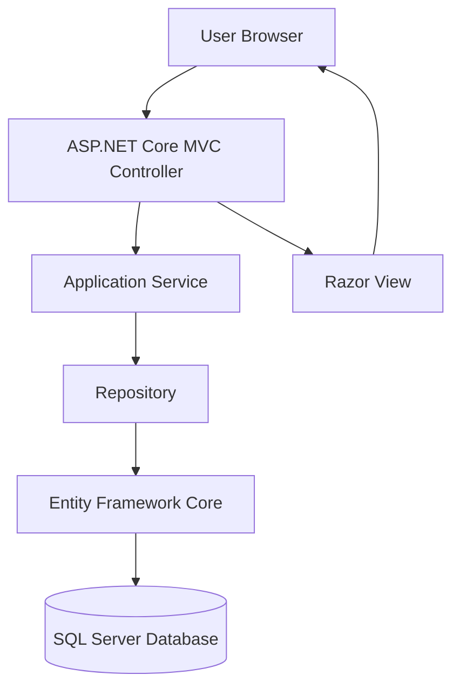

# MovieShopApp 🎥

**Full-Stack Movie Store Web Application using ASP.NET Core MVC**

**Technologies:** C# | .NET 10 | ASP.NET Core MVC | Razor Views | Entity Framework Core | SQL Server | Bootstrap

## Overview

MovieShopApp is a full-stack movie-store prototype built using ASP.NET Core MVC, C#, Razor Views, Entity Framework Core, and Microsoft SQL Server.

The application demonstrates the development of a database-backed web application with movie browsing, detailed movie information, genre filtering, user registration and login forms, reviews, favorites, and purchase-recording workflows.

The project follows a layered architecture that separates the presentation layer, business logic, and database operations.

It was developed to gain practical experience in full-stack .NET development, server-side rendering, relational database design, and application workflows.

Some user and security features are currently prototypes rather than production-ready implementations.

## Project Objectives

The main objectives of this project are to:

- Build an ASP.NET Core MVC web application.
- Implement server-rendered pages using Razor Views.
- Organize business logic using services and repositories.
- Integrate SQL Server through Entity Framework Core.
- Model relationships between movies, users, and transactions.
- Implement movie browsing and user interaction workflows.
- Practice dependency injection and separation of concerns.
- Understand how browser requests interact with backend application services.

## Features

### 1. Movie Browsing

- Display movie listings on the home page.
- Retrieve movies through backend application services.
- Allow users to navigate to individual movie details.
- Display related movie information from the database.

### 2. Movie Details

Movie details pages support information such as:

- Movie title.
- Overview.
- Rating.
- Genre.
- Cast.
- Trailer information.

Movie information is retrieved through application services and Entity Framework Core.

### 3. Genre Browsing

- Browse movies belonging to a selected genre.
- Retrieve genre-related movies from the database.
- Support pagination.
- Navigate between pages of results.

### 4. Cast Information

- Display cast-member information.
- Retrieve movies associated with cast members.
- Use AJAX functionality for selected cast-related interactions.

### 5. Account Registration and Login

The application contains account-related forms and backend operations, including:

- Registration forms.
- Login forms.
- Account-related service methods.
- Credential checking.

**Current limitation:** The application does not yet establish a complete persistent authenticated session following a successful login.

Therefore, registration and login should be considered prototype functionality rather than production-ready authentication.

### 6. Movie Reviews

- Provide a review submission workflow.
- Process review information through MVC controllers.
- Pass operations to application services.
- Store review-related information through the data access layer.

Some user actions currently use a temporary hard-coded user context.

### 7. Favorites

- Support adding movies to favorites.
- Retrieve favorite movie information.
- Organize favorites-related functionality through application services.

The current implementation requires secure authenticated-user integration before production use.

### 8. Purchase Recording

- Provide a movie purchase-recording workflow.
- Store purchase records in SQL Server.
- Associate purchase information with movie and user records.

**Important:** This functionality records purchases in the application database. It is not an integrated payment-processing system.

### 9. Administration

The application contains administrative controller and service functionality for user and report-related operations.

Secure administrator authorization is not yet implemented.

## Technology Stack

| Category | Technology |
|---|---|
| Language | C# |
| Framework | ASP.NET Core MVC, .NET 10 |
| Frontend | Razor Views, HTML, Bootstrap |
| Backend | ASP.NET Core |
| Database | Microsoft SQL Server |
| ORM | Entity Framework Core |
| Architecture | Layered Architecture |
| Design Patterns | Repository Pattern, Dependency Injection |
| Version Control | Git, GitHub |
| Development Tools | .NET CLI, Visual Studio |

## Project Architecture

The solution follows a layered application architecture.

### ApplicationCore

Contains application entities, models, and interfaces.

### Infrastructure

Contains database access, repositories, service implementations, and supporting functionality.

### MovieShopAppMVC

Contains the application's MVC controllers, Razor views, static assets, and configuration.

## Project Structure

```text
MovieShopApp/
│
├── ApplicationCore/
│   ├── Entities/
│   ├── Models/
│   └── Contracts/
│
├── Infrastructure/
│   ├── Data/
│   ├── Repositories/
│   ├── Services/
│   └── Helpers/
│
├── MovieShopAppMVC/
│   ├── Controllers/
│   ├── Views/
│   ├── wwwroot/
│   ├── Program.cs
│   └── appsettings.json
│
└── MovieShopApp.slnx
```

This is a simplified representation of the application architecture.

## Application Workflow



### Example: Movie Details Workflow

1. A user visits the website.
2. The user selects a movie.
3. The MVC controller receives the movie ID.
4. The controller calls the movie service.
5. The service uses a repository to retrieve movie information.
6. Entity Framework Core accesses SQL Server.
7. The results are returned to the controller.
8. The controller sends a model to the Razor view.
9. The browser displays the movie details.

## Database Design

The project uses Entity Framework Core to manage relational data.

### Main Entities

**Movie Catalog**

- Movie
- Genre
- Trailer
- Cast
- Crew

**User Management**

- User
- Role
- UserRole

**User Interaction**

- Review
- Favorite
- Purchase

**Administration**

- Report

### Database Relationships

The database supports relationships between:

- Movies and genres.
- Movies and cast members.
- Movies and crew.
- Users and roles.
- Users and reviews.
- Users and favorite movies.
- Users and purchase records.

Entity Framework Core configurations and navigation properties support these relationships.

## MVC Routes

Examples of application routes include:

| Route | Purpose |
|---|---|
| `/` | Home page and movie browsing |
| `/Movies/Details/{id}` | Movie details |
| `/Movies/Genre/{id}` | Genre-based movie listing |
| `/Movies/MoviesByGenre/{id}` | Paginated genre browsing |
| `/Cast/Details/{id}` | Cast details |
| `/Account/Register` | User registration |
| `/Account/Login` | Login |
| `/User/AddReview?movieId={id}` | Review form |
| `/User/Favorites` | Favorite movies |
| `/User/Purchases` | Purchase records |

Some routes depend on database records, supporting Razor views, and prototype user context.

## Installation Instructions

### Prerequisites

- .NET 10 SDK
- SQL Server
- Git
- Visual Studio or another compatible IDE

### Step 1: Clone the Repository

```bash
git clone https://github.com/Yashaswini944/MovieShopApp.git
cd MovieShopApp
```

### Step 2: Restore Dependencies

```bash
dotnet restore MovieShopApp.slnx
```

### Step 3: Build the Application

```bash
dotnet build MovieShopApp.slnx
```

### Step 4: Configure the Database

The application reads:

```text
ConnectionStrings:MovieShopDb
```

Configure the connection for your SQL Server instance.

Avoid committing passwords or other secrets to source control.

### Step 5: Prepare Database Tables and Data

The application requires the appropriate SQL Server schema and movie records.

Use validated Entity Framework Core migrations if they are available in the project.

Database creation and seeding are not assumed to happen automatically.

### Step 6: Run the Application

```bash
dotnet run --project MovieShopAppMVC/MovieShopAppMVC.csproj --launch-profile http
```

### Step 7: Open the Website

The checked-in HTTP launch profile uses:

```text
http://localhost:5070
```

Open the address displayed in your terminal.

## Application Workflows

### Movie Browsing Workflow

1. Open the website.
2. Browse available movies.
3. Select a movie.
4. View detailed information.
5. Navigate through genres.
6. Explore cast-related movie information.

### Account Workflow

The application includes registration and login forms supported by backend account services.

A complete secure authentication system still needs to be implemented.

### Review Workflow

1. Navigate to a movie.
2. Open the review form.
3. Provide review information.
4. Submit the review.
5. The MVC controller forwards the operation to the service layer.
6. The service performs the associated data operation.

### Favorites Workflow

1. Select a movie.
2. Use the favorites action.
3. The application forwards the action to its service layer.
4. The associated favorite record can be managed through the database-backed functionality.

### Purchase Recording Workflow

1. Select a movie.
2. Open the purchase-recording page.
3. Submit the purchase-related information.
4. The application records the purchase using the service and repository layers.

This workflow does not charge a payment method.

## Testing and Validation

The following are suggested manual validation scenarios.

| Scenario | Validation |
|---|---|
| Home page | Movie records display correctly |
| Movie details | Correct movie information is shown |
| Genre browsing | Correct genre movies are returned |
| Pagination | Navigation retrieves expected pages |
| Registration | Input is handled and stored as intended |
| Login | Valid and invalid credentials are distinguished |
| Review | Review data can be processed |
| Favorites | Favorite records can be managed |
| Purchase record | Purchase information is persisted |

These describe validation targets, not verified automated test results.

## Security Considerations

The project demonstrates account-related application workflows, but further security development is required before production deployment.

Important improvements include:

- Implementing ASP.NET Core Identity or another secure authentication solution.
- Creating and validating authenticated sessions.
- Adding role-based authorization.
- Replacing temporary user IDs with authenticated-user information.
- Using approved password hashing.
- Adding server-side validation.
- Protecting state-changing operations.
- Improving error handling and logging.
- Securing administrative operations.

## Current Limitations

- Authentication does not currently establish persistent secure login sessions.
- Some user-specific actions rely on a temporary hard-coded user ID.
- Administrative functionality lacks complete authorization enforcement.
- Purchase functionality records a transaction but does not process payments.
- File-upload functionality is not implemented as a verified complete workflow.
- Automated test coverage has not been established.
- A live production deployment is not documented.

## Future Enhancements

### Authentication and Authorization

Implement ASP.NET Core Identity with secure login sessions, logout, and role-based authorization.

### Improved User Management

Link reviews, purchases, and favorites to the currently authenticated user.

### Input Validation

Improve form validation and enforce business rules through server-side checks.

### Automated Testing

Introduce unit tests, integration tests, and continuous integration using GitHub Actions.

### Database Improvements

Document repeatable migrations and provide safe development seed data.

### API Integration

Optionally integrate the MVC application with the separate MovieShopAPI REST service.

Currently, MovieShopApp uses its own backend services and repositories directly rather than communicating with MovieShopAPI.

### Application Deployment

Prepare the application for secure hosting with environment-specific configuration.

## Skills Demonstrated

Through this project, I gained practical experience in:

- ASP.NET Core MVC development.
- Full-stack application architecture.
- Razor Views.
- Server-side web application workflows.
- C# and object-oriented programming.
- SQL Server integration.
- Entity Framework Core.
- Repository Pattern.
- Dependency Injection.
- Relational database design.
- Model binding and routing.
- Debugging application functionality.
- Separation of concerns.

## Related Backend API Project

**MovieShopAPI**

https://github.com/Yashaswini944/MovieShopAPI

This separate project demonstrates RESTful API development using ASP.NET Core Web API, Entity Framework Core, and SQL Server.

## Author

**Project Type:** Full-Stack Web Development / ASP.NET Core MVC / SQL Server
